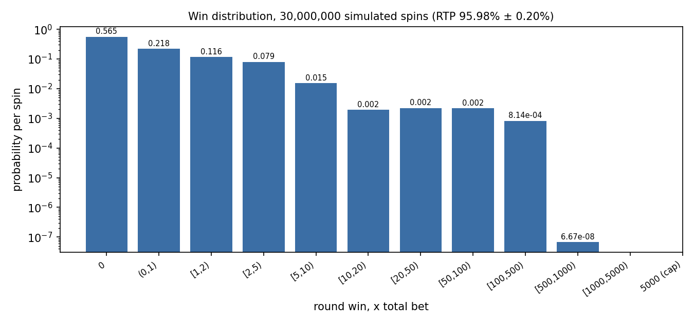

# Demo slot math: 5x5, 15 fixed lines, free spins

Model `demo-5x5-15-lines`, version `2569fe3c2a975577` (SHA-256 of model.json, first 16 hex).
Built with `python build_model.py`, checked with `python run.py --spins 30000000 --bonus-rounds 2000000 --seed 7`
on Python 3.13.14, numpy 2.4.2. Run time 141 s.

This is a demonstration model built for the brief, not a certified game.

## Rules

- 5 reels, 5 rows, 15 fixed lines (`paylines` in model.json), total bet = 15 line bets.
- Line wins pay left to right from reel 1. A line pays the larger of the leading wild run and
  the run of the first non-wild symbol with wilds substituting. Scatters never pay on lines.
- 3, 4 or 5 reels showing a scatter pay 2, 10 or 50 x bet and award 10 free spins.
- Free spins use their own reel strips with more wilds, line wins x3.
  3+ scatters during free spins add 10 spins, up to 50 spins per round.
- Maximum win 5,000 x bet per round (base spin plus its free spins).

## Exact results

| Measure | Value |
|---|---|
| RTP | **96.0022%** |
| base game lines | 62.2843% |
| base game scatter pays | 1.2137% |
| free spins | 32.5043% |
| free spins trigger | 1 in 196.5 spins |
| expected free spins per round | 10.5360 |
| retrigger chance per free spin | 0.5088% |
| average free-spin round | 63.887 x bet |
| 5 wilds on a given line, base | 1 in 48,600,000 |
| 5 wilds on a given line, free spins | 1 in 80,966 |

Method: every row of a circular strip has the strip's symbol frequencies, so one line's expected
pay is a sum over all 9^5 symbol combinations with their exact probabilities, and 15 lines at
1/15 of the bet make it the line RTP. Scatters sit at least 5 stops apart, so a reel shows at most
one, and the number of scatter reels is a convolution of five Bernoulli terms. The free-spin round
value is expected spins (exact recursion over remaining and awarded spins, including the 50-spin
limit) times the expected win per free spin, which holds by Wald's identity because whether a spin
is played depends only on earlier spins.

## Simulation cross-check

Full game, 30,000,000 spins, seed 7:

| Measure | Value |
|---|---|
| RTP | 95.982% ± 0.204% (95%) |
| hit rate (any win) | 43.50% |
| free spins trigger | 1 in 196.7 spins |
| standard deviation per spin | 5.70 x bet |
| largest round win | 555.6 x bet |
| rounds reaching the 5,000 x cap | 0 |

Stratified check (base game and free-spin rounds simulated separately, combined with the exact
trigger chance), 30,000,000 base spins and 2,000,000 free-spin rounds:

| Measure | Simulated | Exact |
|---|---|---|
| RTP | 95.962% ± 0.055% | 96.002% |
| average free-spin round | 63.87 ± 0.06 x bet | 63.89 x bet |
| spins per round | 10.5334 | 10.5360 |
| rounds of 500 x bet or more | 0.0013% | |
| rounds of 1,000 x bet or more | 0.0000% | |
| largest free-spin round | 657.8 x bet | |

## Win distribution (full game)

| Round win, x bet | Spins | Probability |
|---|---|---|
| 0 | 16,950,834 | 5.650e-01 |
| (0,1) | 6,535,368 | 2.178e-01 |
| [1,2) | 3,468,502 | 1.156e-01 |
| [2,5) | 2,372,311 | 7.908e-02 |
| [5,10) | 458,834 | 1.529e-02 |
| [10,20) | 57,908 | 1.930e-03 |
| [20,50) | 66,493 | 2.216e-03 |
| [50,100) | 65,341 | 2.178e-03 |
| [100,500) | 24,407 | 8.136e-04 |
| [500,1000) | 2 | 6.667e-08 |
| [1000,5000) | 0 | 0.000e+00 |
| 5000 (cap) | 0 | 0.000e+00 |



## Rare and capped outcomes

- Structural maximum per spin: base 1,050 x bet (5 wilds on all 15 lines plus 5 scatters),
  free spin 3,050 x bet. The real maximum is lower, because no strip holds 5 wilds in a row.
- Over a 50-spin round the structural bound is far above the 5,000 x cap, so the cap is a
  real rule, but the simulation never reached it. In a full engagement its effect on RTP is
  measured with importance sampling (free-spin strips tilted toward wilds, results reweighted by
  the likelihood ratio), so the cap's share of RTP comes with an error bar instead of "zero hits".

## Worked examples

Base win, stops [46, 36, 4, 3, 55]:

```
Window (reels left to right, top row first):
  H3 L2 H2 L2 L3
  H2 L3 H1 H2 L3
  L4 L2  W L2 L4
  L3  W L4 L1 H2
  H3 L4 L4 H3 L2
  line  7 [4, 3, 2, 1, 0]: H3 W W H2 L3 -> 25 line bets = 1.667 x bet
  line 13 [2, 3, 2, 1, 2]: L4 W W H2 L4 -> 5 line bets = 0.333 x bet
  total 2.000 x bet
```

Free spins trigger, stops [53, 59, 6, 57, 59]:

```
Window (reels left to right, top row first):
  L1 L4  W L1 L2
  L2  S L4 L3  S
  H2 H2 L4 L2 L1
  L4 L3 H3  S L1
  L3 L2 L3 L3 L4
  line 11 [4, 3, 4, 3, 4]: L3 L3 L3 S L4 -> 8 line bets = 0.533 x bet
  scatters on 3 reels -> 2 x bet
  total 2.533 x bet; 3 scatters trigger free spins
```

One free-spin round:

```
  spin  1: stops [3, 28, 36, 54, 29] -> 0.000 x bet
  spin  2: stops [43, 38, 38, 34, 17] -> 6.400 x bet
  spin  3: stops [41, 44, 38, 14, 12] -> 0.000 x bet
  spin  4: stops [2, 54, 18, 22, 24] -> 11.800 x bet
  spin  5: stops [8, 3, 22, 26, 57] -> 2.400 x bet
  spin  6: stops [31, 52, 41, 55, 37] -> 49.000 x bet
  spin  7: stops [25, 2, 13, 47, 9] -> 10.000 x bet
  spin  8: stops [2, 33, 29, 51, 3] -> 0.000 x bet
  spin  9: stops [58, 25, 36, 8, 40] -> 3.200 x bet
  spin 10: stops [52, 46, 53, 34, 14] -> 7.000 x bet
  round total 89.800 x bet over 10 spins
```
